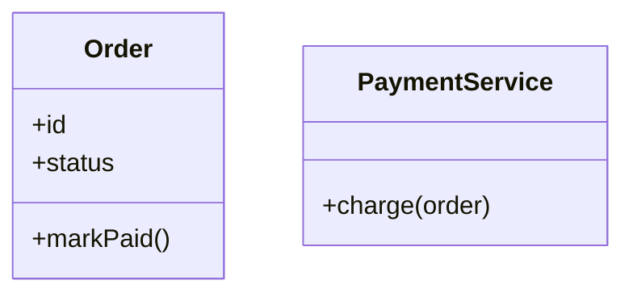
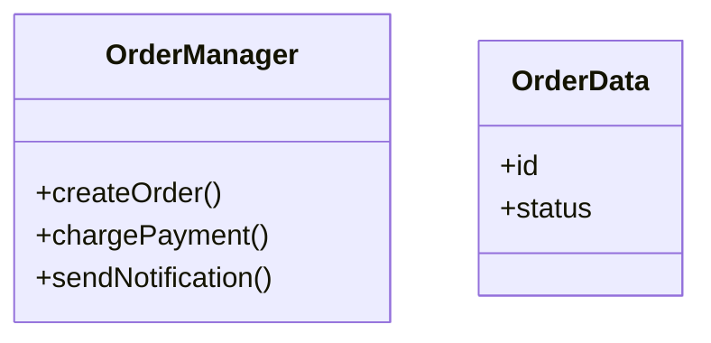
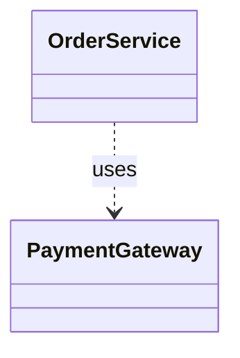
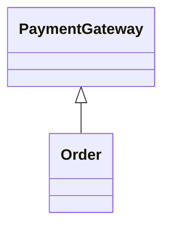
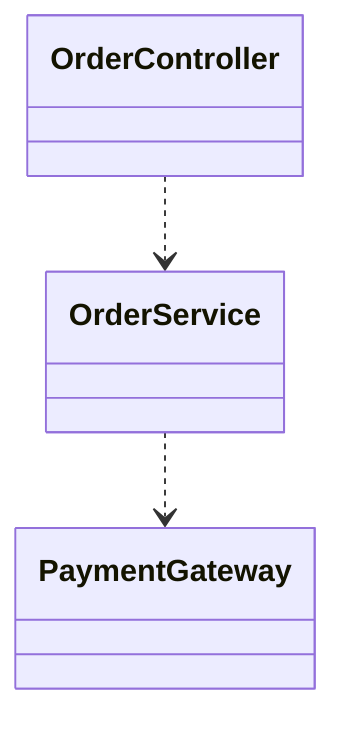
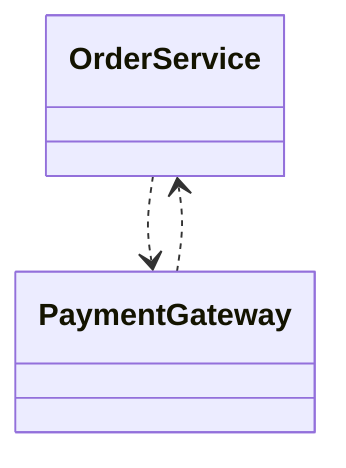
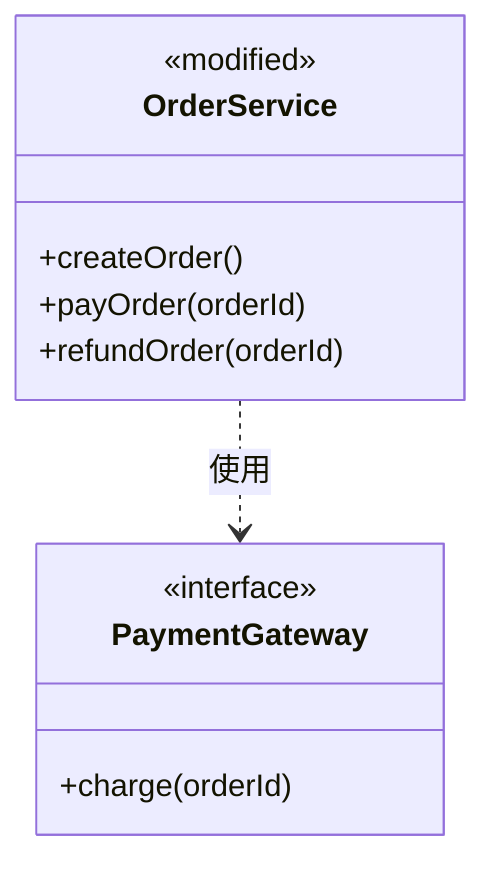
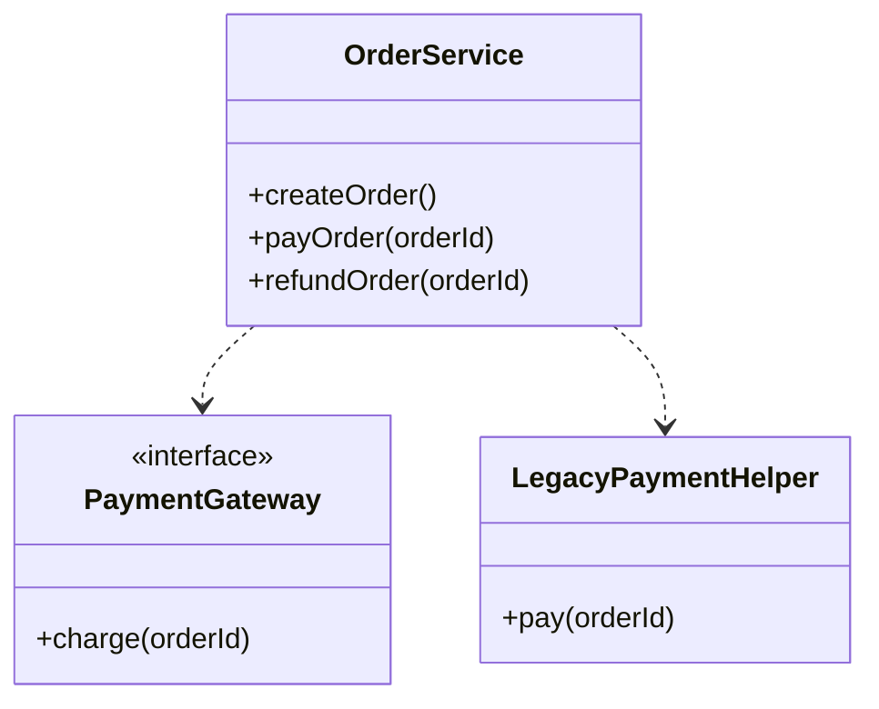

# Rule 1 - 類別應對應必要且職責清楚的概念

- Level: `SHOULD`
- 只納入實現需求或表達重要設計所需的類別與介面；避免為了讓圖看起來完整而加入無實際責任的類別。
- 每個類別應有可辨識的主要責任；若類別承擔互不相關的工作，應考慮拆分，若多個類別只為轉傳資料而存在，應考慮合併或移除。

## Good Example

- `Order` 管理訂單狀態，`PaymentService` 負責付款處理，兩者各自對應不同責任。



## Bad Example

- `OrderManager` 同時管理訂單、付款、寄送通知，類別責任混雜；`OrderData` 只包裝資料卻沒有清楚用途。



# Rule 2 - 類別關係必須符合其語意

- Level: `MUST`
- 只呈現與本次設計相關的關係，並依實際語意選擇繼承、組合或依賴；不可為了連線而建立關係。
- 只有明確的「是一種」關係才使用繼承；只有整體負責部件生命週期或擁有部件時才使用組合；單純呼叫或使用另一類別時使用依賴。

## Good Example

- `OrderService` 使用 `PaymentGateway` 完成付款，因此以依賴表示；訂單不繼承付款閘道，也不擁有付款閘道的生命週期。



## Bad Example

- `Order` 與 `PaymentGateway` 沒有「是一種」關係，卻錯誤使用繼承；圖中的箭頭因此誤導實際設計。



# Rule 3 - 實作順序應尊重依賴關係

- Level: `SHOULD`
- 優先先實作被依賴且可獨立驗證的類別，再實作依賴方與整合層。
- 若類別間形成循環依賴，先在設計中釐清或打破循環，再提出實作順序；不可假裝存在單向的拓撲順序。

## Good Example

- 先定義付款閘道介面，再實作訂單服務，最後接上控制器；依賴方向清楚，實作順序可逐步驗證。



## Bad Example

- `OrderService` 與 `PaymentGateway` 互相依賴，卻直接宣稱先做其中一方即可，沒有處理循環依賴。



# Rule 4 - 既有專案變更必須區分圖內新增與修改及圖外刪除項

- Level: `MUST`
- 對於本次新增或修改的主要類別，應在圖中以 UML stereotype `<<new>>` / `<<modified>>` 標註；未變更但作為依賴上下文呈現的既有類別則不加變更標註。
- 若有刪除項，預設在圖外的 `刪除項` 區塊以 `<<to-be-removed>>` 條列（無刪除時填「無」）；只有當刪除本身直接影響設計判讀（例如需要對比新舊依賴替換關係）時，才將 `<<to-be-removed>>` 類別畫進圖中。
- 不可使用 `+` 或 `-` 作為新增或刪除標記，以免與 UML 可見度修飾詞（`public`、`private`）混淆。

## Good Example

- 圖中對新增與修改類別分別以 `<<new>>` 與 `<<modified>>` 標註，並將一般淘汰類別於圖外 `刪除項` 以 `<<to-be-removed>>` 條列。

````md


- 刪除項：`<<to-be-removed>> LegacyPaymentHelper`（已由 `PaymentGateway` 取代，移除舊有靜態扣款輔助類別）。
````

## Bad Example

- 把全新類別 `PaymentGateway`、修改既有類別 `OrderService` 與即將刪除的 `LegacyPaymentHelper` 全部畫成無標記的相同方塊，讀者無法分辨本次實際變更範圍。

````md

````


