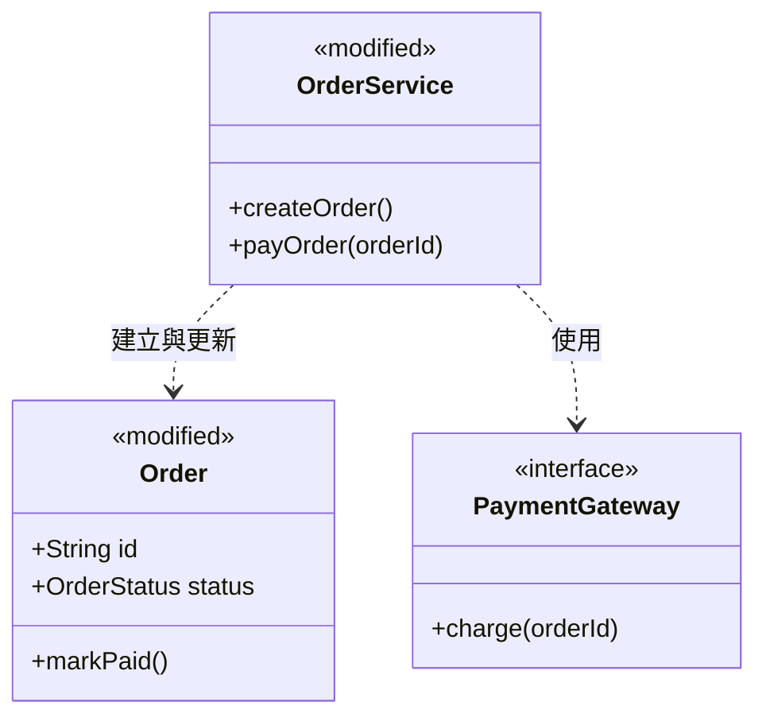

## 類別設計

## 設計說明

- 類別職責：`PaymentGateway`（`<<new>>`）定義可替換的付款介面；`Order`（`<<modified>>`）保存訂單資料與狀態，新增 `markPaid()` 更新付款狀態；`OrderService`（`<<modified>>`）協調建立訂單與付款流程，調整 `payOrder(orderId)` 改由 `PaymentGateway` 扣款。
- 刪除項：`<<to-be-removed>> LegacyPaymentClient`（原本直接耦合於 `OrderService` 的舊版付款類別，改由 `PaymentGateway` 介面取代後移除）。
- 關係與設計意圖：`OrderService` 建立或更新 `Order`，並依賴 `PaymentGateway` 執行付款，避免綁定特定付款供應商。
- 實作順序：先新增 `PaymentGateway` 介面，再修改 `Order` 與 `OrderService` 整合新付款流程，最後移除 `LegacyPaymentClient`。
