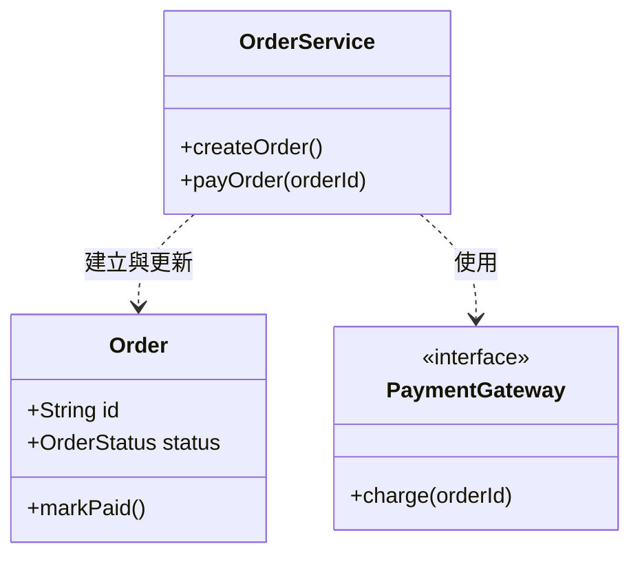

## 類別設計

## 設計說明

- 類別職責：`Order` 保存訂單資料與狀態；`OrderService` 協調建立訂單與付款流程；`PaymentGateway` 定義可替換的付款介面。
- 關係與設計意圖：`OrderService` 建立或更新 `Order`，並依賴 `PaymentGateway` 執行付款，避免綁定特定付款供應商。
- 實作順序：先定義 `PaymentGateway` 介面，再實作 `Order` 與 `OrderService`，最後整合付款流程。
