# 台鋼新零售全端工程師筆試｜情境一、二

> 本稿依題目提供的條件作答。未明確指定的實作細節會標成設計假設；類別圖用來表達領域角色、責任與依賴，不代表唯一實作方式。

# 情境一｜一張票，誰的權益？

## 第 1 題：區分購買人、持有人、訂單、票券與兌換紀錄

| 概念 | 在情境中的角色 | 本例中的資料／行為 |
|---|---|---|
| 購買人 | 建立並付款購買訂單的人，屬於訂單的原始交易資訊。 | 甲是購買人。轉贈後仍保留在訂單上，不因轉贈改成乙。 |
| 訂單 | 記錄一次購買交易及付款狀態；可包含多張票。 | 甲的訂單包含 T1、T2。 |
| 票券 | 可獨立持有及使用的權益單位；各自有 ID、有效狀態與目前持有人。 | T1 與 T2 是不同票券，權益分開判斷。 |
| 目前持有人 | 目前有權操作該票券的人，可能不同於購買人。 | 甲把 T1 轉贈乙後，T1 持有人是乙；T2 仍由甲持有。 |
| 贈品兌換紀錄 | 記錄某張票對某種贈品是否已核銷、由誰操作及時間。 | 至少關聯 `ticketId`、`giftType`；可記錄 `redeemedBy`、`redeemedAt`。 |

資料上應將訂單的 `purchaserId` 與每張票券的 `currentHolderId` 分開保存。轉贈 T1 只更新 T1 的目前持有人，不改變購買人或 T2 的持有人。核銷時檢查操作者是否為該票目前持有人。

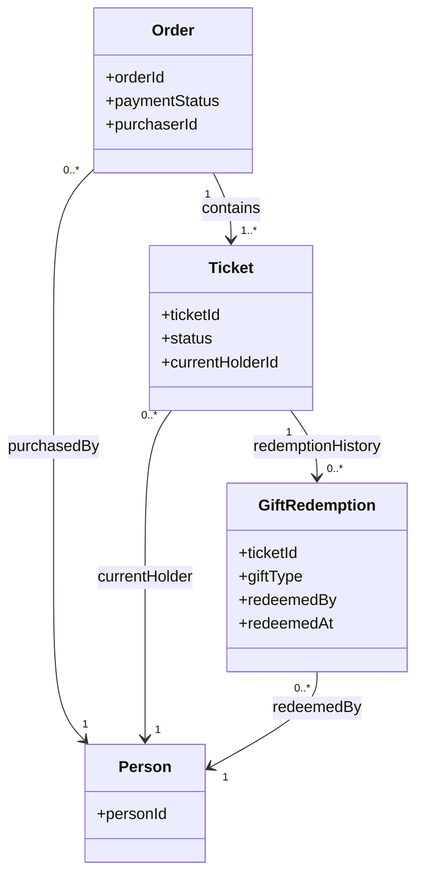

## 第 2 題：挑選重要業務規則並放進模型

| 規則 | 模型責任 | 防止的錯誤 |
|---|---|---|
| 只有已付款且有效票券的目前持有人能核銷贈品。 | 核銷用例依訂單付款狀態、票券狀態與目前持有人授權核銷。 | 未付款、失效票或非持有人不能核銷。 |
| 同一張票對同一種贈品最多核銷一次；轉贈不重置次數。 | 兌換紀錄以 `(ticketId, giftType)` 唯一識別，資料庫設定 `UNIQUE (ticket_id, gift_type)`。 | 轉贈或重複請求不能再次領取同一種贈品；不同票或不同贈品仍各自判斷。 |

我會採用第二條作為核心不變條件：核銷紀錄綁定票券與贈品種類，不綁定持有人。`redeemedBy` 只作為稽核資訊，不放進唯一鍵。

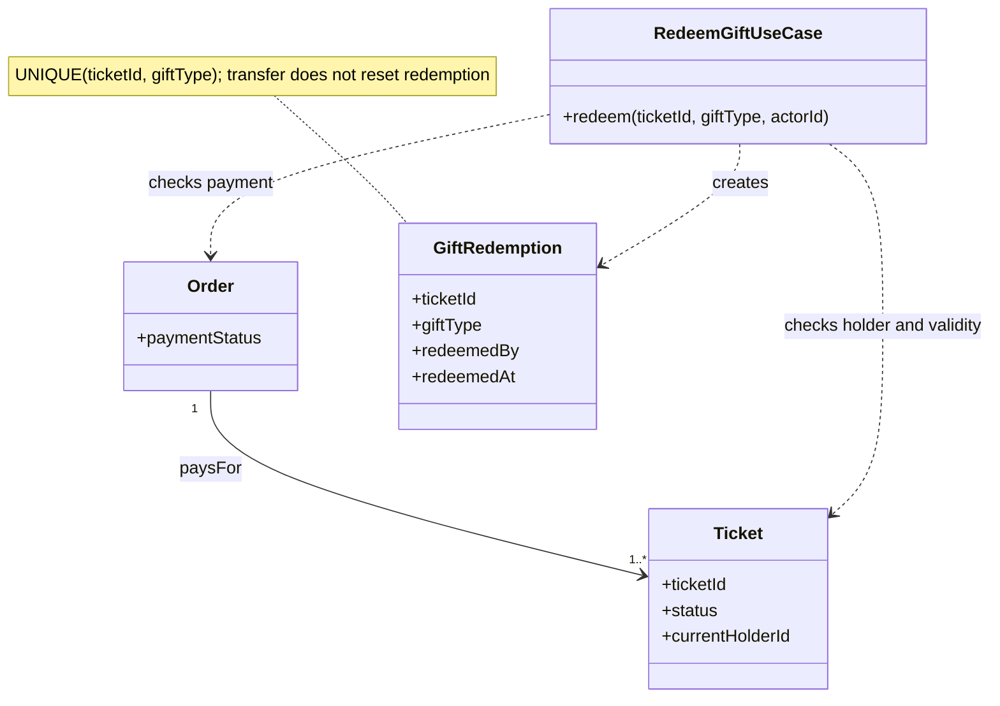

贈品核銷與入場驗票是不同權益，因此入場紀錄不應被當成贈品兌換紀錄，兩者的狀態與規則也不互相推論。

## 第 3 題：前台顯示與後台核銷如何使用規則

| 位置 | 如何使用規則 | 為什麼 |
|---|---|---|
| 前台可兌換提示 | 查詢目前持有人、付款與有效狀態，以及 `(ticketId, giftType)` 是否已有兌換紀錄，再顯示可否領取。 | 提供即時 UX 提示，但只是查詢當下的結果。 |
| 後台核銷命令 | 收到核銷請求後重新驗證操作者、付款、票券有效性及是否已核銷，並在交易內寫入紀錄。 | 前台狀態可能過期，且多個櫃台可能同時核銷，不能信任前端結果作為最終授權。 |
| 並行保護 | 對票券列使用交易鎖（例如 `SELECT ... FOR UPDATE`），並在兌換紀錄設定 `UNIQUE (ticket_id, gift_type)`。若唯一鍵衝突，回 `409 Conflict`。 | 鎖使同票操作在交易中序列化；唯一約束是資料庫最後防線，避免競態造成重複紀錄。 |

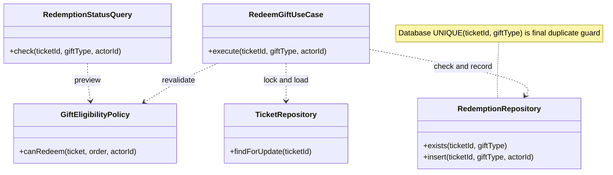

# 情境二｜換了金流服務商，哪些事不該變？

## 第 1 題：分配責任與說明依賴

| 工作 | 責任歸屬 | 依賴方向／理由 |
|---|---|---|
| 解析 HTTP、驗證輸入 | 網站或客服入口 Adapter（Controller）。 | 將不同入口的請求轉成應用程式可使用的輸入，不承載退款資格規則。 |
| 判斷退款資格與金額 | 退款領域規則／Use Case 所使用的領域模型。 | 屬於內部業務規則，不依賴金流商 SDK。 |
| 協調退款流程 | `RefundUseCase`。 | 負責載入訂單、套用規則、建立退款申請、呼叫 Port、保存結果及觸發通知。 |
| 存取訂單與退款資料 | `OrderRepository`、`RefundRepository` Port；由資料庫 Adapter 實作。 | Use Case 依賴抽象介面，不直接依賴資料庫技術。 |
| 呼叫外部金流 | `PaymentGateway` Port；由金流 Adapter 實作並使用供應商 SDK。 | SDK、欄位格式與錯誤碼留在 Adapter，避免污染內部規則。 |
| 寄送狀態通知 | `RefundNotifier` Port；由通知 Adapter 實作。 | 退款流程依賴通知能力的抽象，而非特定郵件或訊息服務。 |

網站與客服後台可各有入口 Adapter，但都呼叫同一個 `RefundUseCase`，共用退款規則。依賴方向上，Use Case 依賴 `PaymentGateway` Port；金流 Adapter 實作此 Port 並向外呼叫 SDK。更換供應商通常只需替換 Adapter；只有新服務商的能力無法由原 Port 表達時才評估調整 Port，退款資格與退款金額規則維持不變。

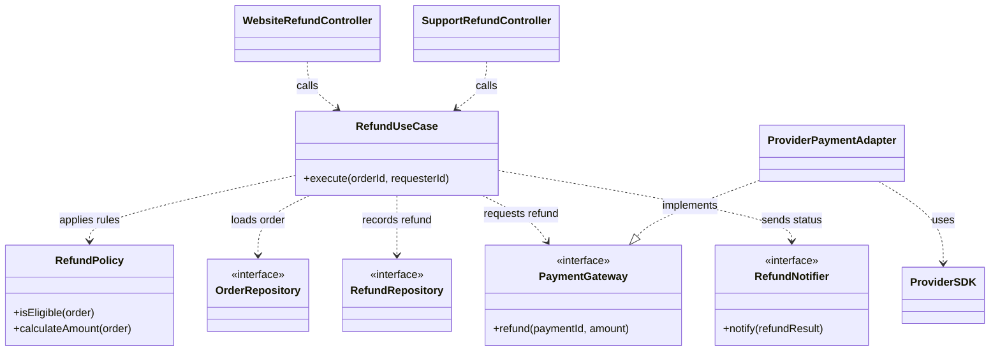

## 第 2 題：設計一個外部系統 Port

| Port 設計項目 | 建議契約 | 說明 |
|---|---|---|
| Port | `PaymentGateway.refund(paymentId, amount)` | 使用內部穩定的付款識別與金額，不暴露供應商 SDK 的欄位名稱。若業務需要，可再加入幣別或冪等鍵。 |
| 輸入 | `paymentId`、`amount` | `orderId` 是本系統訂單識別；若金流商需要付款交易 ID，Use Case 先由訂單資料取得 `paymentId` 再呼叫 Port。 |
| 回傳 | `status`、`providerRefundId`、可選的 `failureReason` | 至少區分 `succeeded`、`failed`、`pending`；成功時保存供應商退款 ID 以便查詢。逾時等結果不確定時保留 `pending`，不要直接當作失敗或盲目重送。 |
| 時間紀錄 | 本系統記錄 `requestedAt`；確定完成後記錄 `completedAt`，未完成時為 `null`。 | 這些是退款流程的稽核資料；完成時間尚未知時不可用送出時間代填。 |

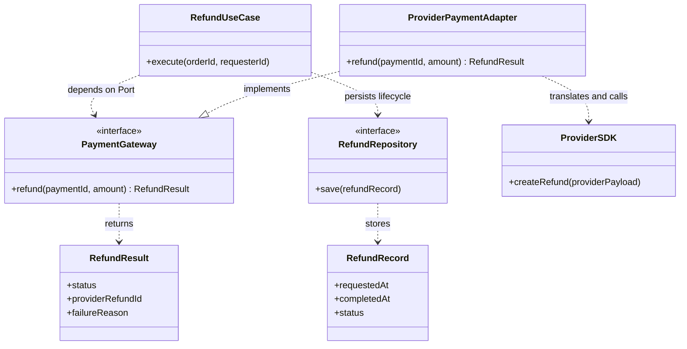

這個 Port 將內部退款流程與外部金流技術隔開。更換 SDK 時由 Adapter 轉換新供應商的請求、回應與錯誤；`RefundUseCase` 的退款資格與金額規則不變。若新供應商提供的能力不符合既有 Port 契約，再經評估後調整 Port，而不是直接把 SDK 型別帶進 Use Case。

## 第 3 題：沒有金流測試帳號時如何測試

| 測試範圍 | 沒有測試帳號能否先測 | 做法／限制 |
|---|---|---|
| 退款資格、金額計算 | 可以。 | 單元測試 `RefundPolicy`，涵蓋合格、不合格及邊界條件。 |
| Use Case 流程 | 可以。 | 注入 Fake `PaymentGateway`，設定成功、失敗、處理中等結果；驗證合格時呼叫參數正確、不合格時不呼叫金流，以及退款結果和通知／紀錄處理正確。 |
| Adapter 對 SDK 的轉換 | 可做部分單元測試。 | Mock SDK 或 HTTP transport，檢查內部 Port 資料如何轉為供應商欄位，以及供應商回應／錯誤如何轉回內部結果；但這不能證明真實連線成功。 |
| 真實認證、網路與供應商請求格式 | 不能完整確認。 | 需等取得金流 Sandbox／測試帳號與憑證，再做整合測試。 |

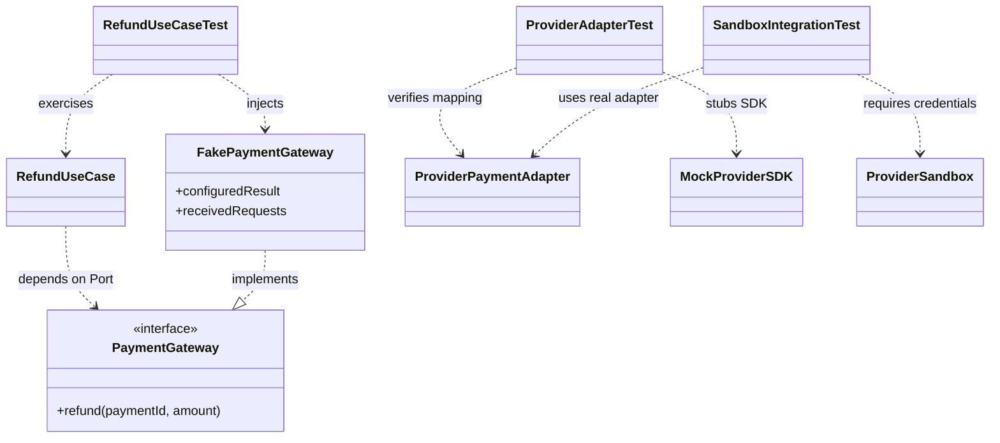

因此，我會先用 Fake 測內部規則與流程，並以 Mock SDK 測 Adapter 的轉換；等有 Sandbox 帳號後，再確認真實認證、網路連線、供應商接受的請求格式及實際回應。測試報告中會清楚區分「已由 Fake／Mock 驗證」與「尚待 Sandbox 驗證」的部分。

# 情境三｜一句需求，離開發還有多遠？

## 第 1 題：最想先確認哪三件事，以及順序

| 排序 | 要向 PM 確認的問題 | 暫定建議 | 答案會影響的決策 |
|---|---|---|---|
| 1 | 退款以整筆訂單還是單張票券為單位？ | 本次先以整單退款為主；單張票券退款暫不支援，待確認是否納入後續範圍。 | 退款資格與金額如何計算、退款狀態要記在訂單還是個別票券，以及使用者選取介面如何呈現。 |
| 2 | 誰可以提出退款？原購買人、目前持有人，或兩者都可以？客服能否代辦？ | 建議自助退款限原購買人；客服可代辦，但要記錄原購買人及實際操作客服。 | 身分授權、客服操作流程、稽核資料，以及退款退回哪筆原付款。 |
| 3 | 退款期限與票券使用狀態如何判斷？ | 尚未驗票使用的票可申請退款；展覽開始後是否仍可退，待 PM 確認。 | 是否需逐張查驗票狀態、期限是否依每張票所屬場次計算，以及展覽開始或結束後未使用的票能否退款。 |

我會先排第 1 題，因為退款範圍會直接決定退款流程與資料模型；第 2 題接著決定授權與操作紀錄；第 3 題再定義每張票的退款資格。若 PM 尚未回答，所有建議都先標為待確認假設。

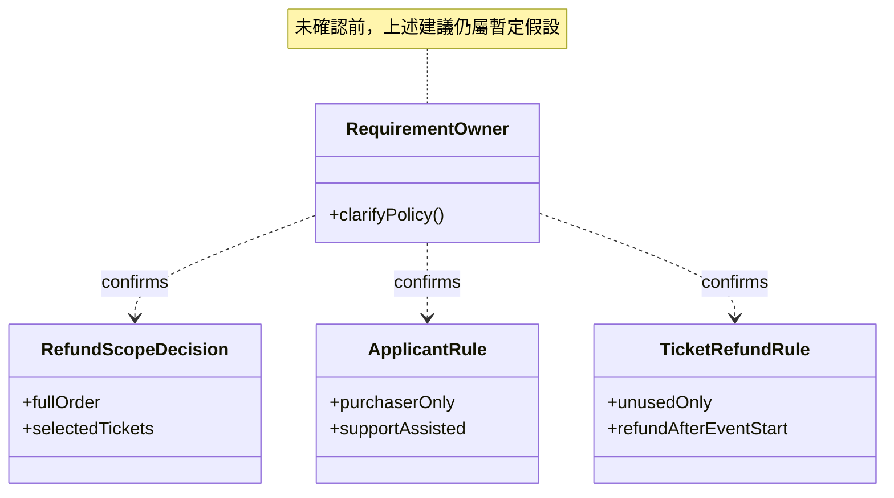

## 第 2 題：採用合理假設整理規格草稿

| 規格面向 | 草稿內容 | 狀態 |
|---|---|---|
| 本次包含 | 會員在網站可針對訂單申請整單退款。系統檢查資格、計算退款金額、建立退款申請並記錄狀態。 | 暫定假設，待 PM 確認。 |
| 本次不包含 | 單張票券退款、已驗票使用的票券退款，以及客服後台代辦的完整介面。單張退款是否納入後續範圍、客服代辦是否需要支援，均待確認。 | 暫定假設，待 PM 確認。 |
| 誰可以申請 | 原購買人可自助申請；客服是否可代辦，待確認。 | 待確認。 |
| 可以退哪些票 | 尚未使用的票券；展覽開始後是否仍可退，待 PM 確認。 | 暫定假設，待 PM 確認。 |
| 退款狀態 | 已提出、資格不符被拒絕、已受理、已送出金流、處理中、已退款、退款失敗。 | 暫定假設，待 PM 確認。 |
| 失敗或重複申請 | 重複提交同一張票時不建立第二筆申請；金流結果不明時標記處理中，不盲目重送。 | 暫定假設，待 PM 確認。 |

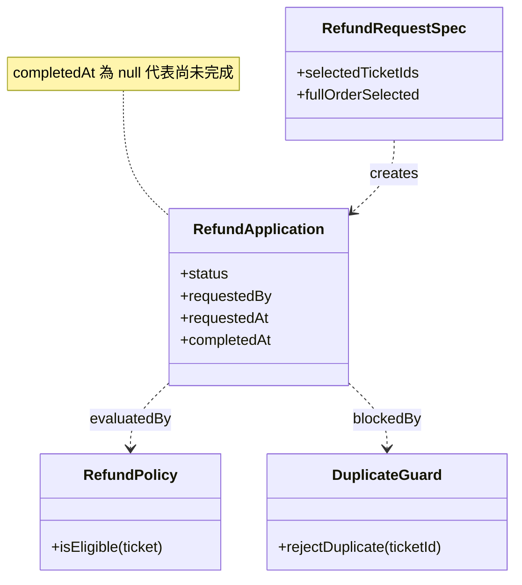

## 第 3 題：提交退款申請的三種結果

| 情況 | 預期回應 | 狀態與後續行為 |
|---|---|---|
| 申請被受理 | 成功建立退款申請。 | 狀態為已受理或處理中；接著送往金流，結果未確定前不標記為已退款。 |
| 不符合資格 | 拒絕申請。 | 例如申請人不是原購買人、票券已驗票使用、或超過該票可退款期限。 |
| 重複提交 | 不建立第二筆退款申請。 | 若同一票已有處理中的申請，回覆重複申請結果，例如 HTTP 409；不可讓兩個同票申請同時進入金流。 |

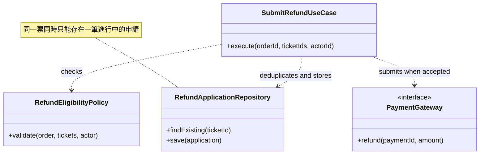

退款流程中的三種結果要分別定義驗收：受理不代表已完成退款；資格不符要明確拒絕；重複提交則以既有申請為準，不另外建立。未確認的退款政策仍以假設標示，待 PM 回答後再更新規格。

# 情境四｜兩個櫃台，能領兩次嗎？

## 第 1 題：排出執行順序，問題出在哪裡

| 步驟 | 請求 A | 請求 B | 結果 |
|---|---|---|---|
| 1 | findRedemption(T1, A) → 無紀錄 | （等待） | A 通過檢查。 |
| 2 | （等待） | findRedemption(T1, A) → 無紀錄 | B 也通過檢查。 |
| 3 | insertRedemption(T1, A) | （等待） | A 核銷成功。 |
| 4 | （等待） | insertRedemption(T1, A) | B 也核銷成功，同票同贈品出現兩筆紀錄。 |

問題出在「檢查」與「寫入」之間有一段時間窗：兩個請求都在對方寫入之前完成查詢，於是都通過檢查。**`await` 只會暫停單一函式的執行，不能跨請求把兩個操作序列化**，更何況這裡是兩個獨立的 API 服務實例。

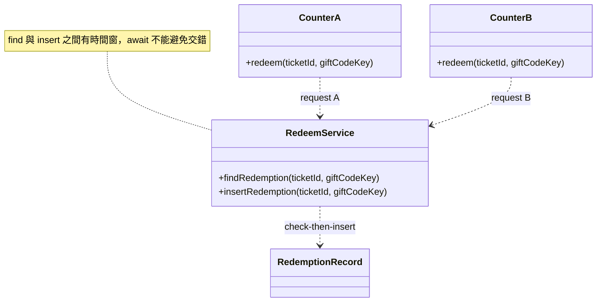

## 第 2 題：最小幅度修正與另一個請求的結果

| 做法 | 如何防止重複 | 另一個請求收到什麼 |
|---|---|---|
| 最小修正：在核銷紀錄表加 `UNIQUE (ticket_id, gift_code_key)`，並在寫入衝突時攔截錯誤。 | 資料庫保證同一組合只會成功寫入一筆；即使兩個請求同時通過檢查，第二個寫入也會失敗。 | 收到 `already_redeemed` 或 HTTP `409 Conflict`，表示該票此贈品已核銷。 |

若要更進一步，可以把「查詢＋寫入」放進同一個交易，並對票券列加鎖（例如 `SELECT ... FOR UPDATE`），讓並行請求序列化；但本題要求最小幅度修正，先加唯一性約束就已足夠擋住重複紀錄。

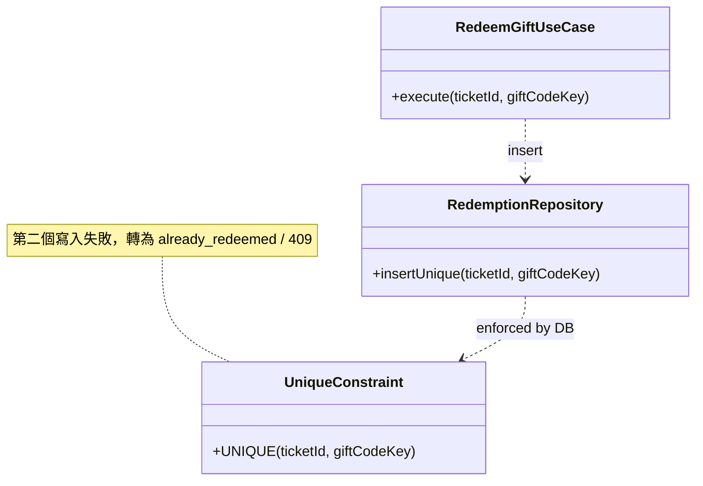

## 第 3 題：怎麼測並行，以及先後呼叫會漏掉什麼

| 測試做法 | 驗證內容 | 依序呼叫會漏掉什麼 |
|---|---|---|
| 用 `Promise.all` 對同一票、同一贈品**同時**送出兩個請求，連接真實資料庫。 | 一個請求成功，另一個回 `already_redeemed` 或 409；資料庫只新增一筆紀錄。 | 依序呼叫時，第二個請求會在第一個完成後才開始查詢，自然看到已核銷；這測不到「同時通過檢查」的競態窗口。 |

測試要連真實資料庫，不能用 mock，否則驗證不到唯一約束是否真的擋住重複寫入。若想提高重現率，可在測試中讓第一個請求在查詢後稍作延遲，刻意拉開時間窗，再同時發出第二個請求。

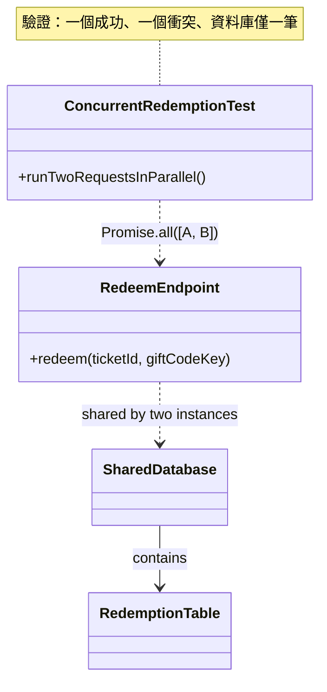

# 情境五｜明明用了 async，為什麼還是卡？

## 第 1 題：「函式有 async、外面也有 await，所以不會阻塞」嗎？

| 說法 | 判斷 | 原因 |
|---|---|---|
| 函式有 `async`，外面也有 `await`，所以不會阻塞。 | 不同意。 | `async`／`await` 是非同步 I/O 的排程語法，不會改變同步程式碼的執行緒行為。 |
| `renderLargeTemplateSync` 在 `map` 迴圈中同步執行。 | 這是阻塞來源。 | 它是耗用 CPU 的同步運算，與購票 API 共用同一條執行緒；迴圈跑完前，event loop 被佔住，其他請求無法被處理。 |
| `await prepareMessages(orders)` 有等待。 | 等待位置幫不上忙。 | 阻塞發生在函式內部的同步迴圈，不是 I/O 邊界；`await` 只能等它完成，不能讓 CPU 運算變成非阻塞。 |

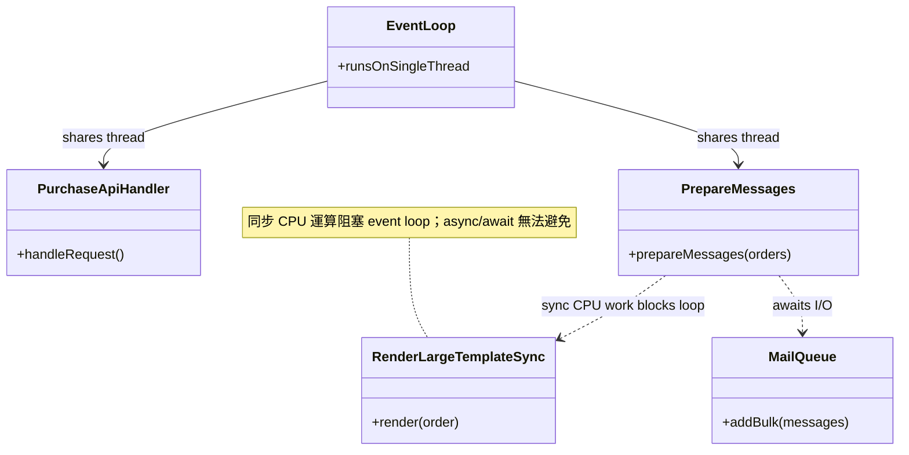

## 第 2 題：再看哪兩項數據或紀錄判斷原因

| 數據／紀錄 | 怎麼看 | 判斷什麼 |
|---|---|---|
| Event loop lag（事件迴圈延遲） | 觀察通知批次執行期間，event loop 延遲是否飆高。 | 若延遲在批次期間明顯上升，代表 event loop 被同步工作佔住，這正是 API 變慢的機制。 |
| 購票 API 的延遲分佈（P95／P99）搭配 CPU profile | 比對 API 延遲飆升的時間點與通知批次的時間點；用 CPU profile／火焰圖找出最耗時的同步函式。 | 確認變慢與通知批次高度相關，且 CPU 熱點集中在 `renderLargeTemplateSync`，而非資料庫或網路 I/O。 |

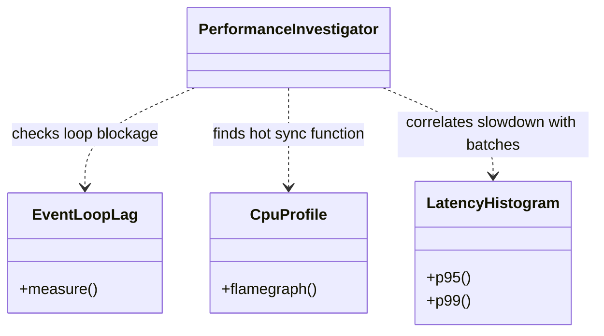

## 第 3 題：先改哪裡、怎麼確認改善

| 工作 | 性質 | 改法 | 驗證方式 |
|---|---|---|---|
| 準備通知（產生信件內容） | CPU-bound 同步運算 | 移到 `worker_threads` 或獨立 worker 程序／工作佇列執行，讓主執行緒空出來處理購票 API。 | 在相同通知批次壓力下，比較修改前後的 event loop lag 與購票 API 的 P95／P99 延遲；目標是批次期間 API 延遲不再明顯上升。 |
| 寄送通知（把內容交給 mail queue） | I/O-bound 非同步操作 | 維持非同步批次送出即可，這段本身不是阻塞主因。 | 觀察 mail queue 的吞吐量與錯誤率，確認移出準備工作後寄送仍正常完成。 |

我會先改「準備通知」，因為它是同步 CPU 運算，正是阻塞 event loop 的直接原因；寄送通知是 I/O，保持非同步即可。

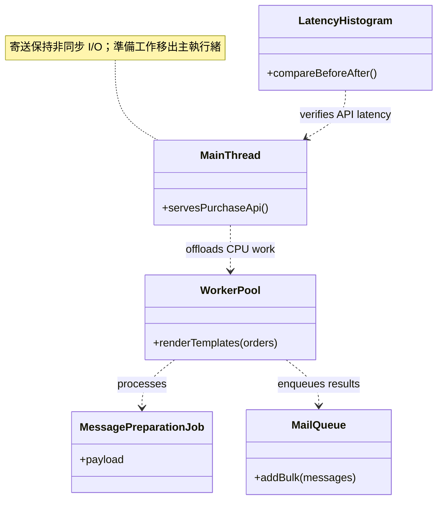
