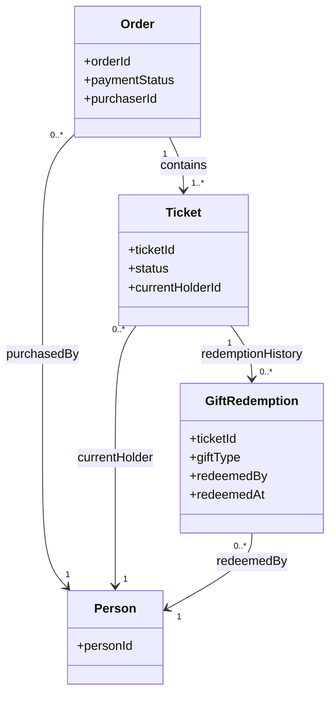
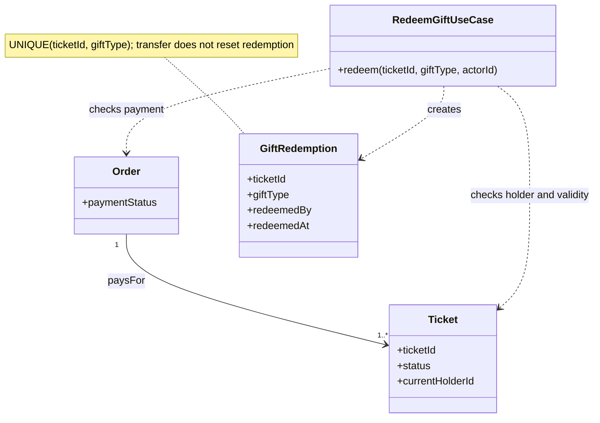
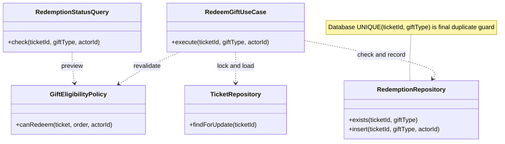
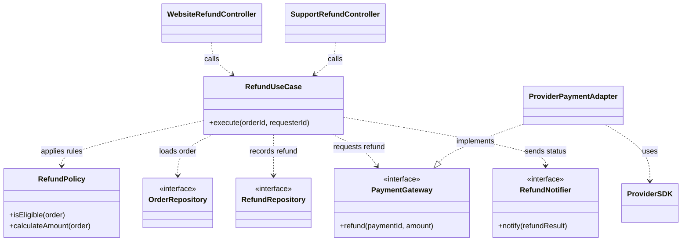
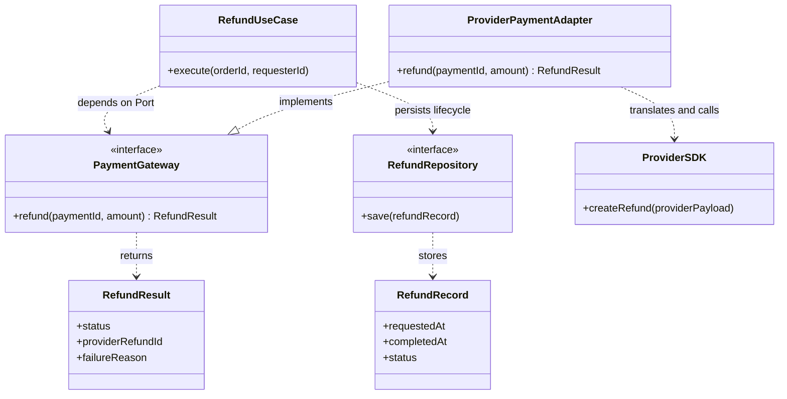
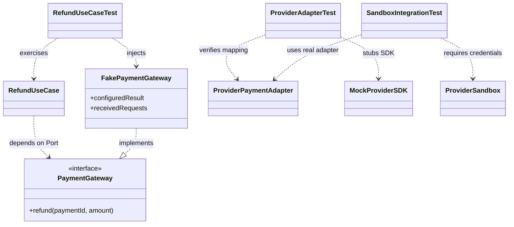

# 台鋼新零售全端工程師筆試｜情境一、二

> 本稿依題目提供的條件作答。未明確指定的實作細節會標成設計假設；類別圖用來表達領域角色、責任與依賴，不代表唯一實作方式。

# 情境一｜一張票，誰的權益？

## 第 1 題：區分購買人、持有人、訂單、票券與兌換紀錄

| 概念 | 在情境中的角色 | 本例中的資料／行為 |
|---|---|---|
| 購買人 | 建立並付款購買訂單的人，屬於訂單的原始交易資訊。 | 甲是購買人。轉贈後仍保留在訂單上，不因轉贈改成乙。 |
| 訂單 | 記錄一次購買交易及付款狀態；可包含多張票。 | 甲的訂單包含 T1、T2。 |
| 票券 | 可獨立持有及使用的權益單位；各自有 ID、有效狀態與目前持有人。 | T1 與 T2 是不同票券，權益分開判斷。 |
| 目前持有人 | 目前有權操作該票券的人，可能不同於購買人。 | 甲把 T1 轉贈乙後，T1 持有人是乙；T2 仍由甲持有。 |
| 贈品兌換紀錄 | 記錄某張票對某種贈品是否已核銷、由誰操作及時間。 | 至少關聯 `ticketId`、`giftType`；可記錄 `redeemedBy`、`redeemedAt`。 |

資料上應將訂單的 `purchaserId` 與每張票券的 `currentHolderId` 分開保存。轉贈 T1 只更新 T1 的目前持有人，不改變購買人或 T2 的持有人。核銷時檢查操作者是否為該票目前持有人。

## 第 2 題：挑選重要業務規則並放進模型

| 規則 | 模型責任 | 防止的錯誤 |
|---|---|---|
| 只有已付款且有效票券的目前持有人能核銷贈品。 | 核銷用例依訂單付款狀態、票券狀態與目前持有人授權核銷。 | 未付款、失效票或非持有人不能核銷。 |
| 同一張票對同一種贈品最多核銷一次；轉贈不重置次數。 | 兌換紀錄以 `(ticketId, giftType)` 唯一識別，資料庫設定 `UNIQUE (ticket_id, gift_type)`。 | 轉贈或重複請求不能再次領取同一種贈品；不同票或不同贈品仍各自判斷。 |

我會採用第二條作為核心不變條件：核銷紀錄綁定票券與贈品種類，不綁定持有人。`redeemedBy` 只作為稽核資訊，不放進唯一鍵。

贈品核銷與入場驗票是不同權益，因此入場紀錄不應被當成贈品兌換紀錄，兩者的狀態與規則也不互相推論。

## 第 3 題：前台顯示與後台核銷如何使用規則

| 位置 | 如何使用規則 | 為什麼 |
|---|---|---|
| 前台可兌換提示 | 查詢目前持有人、付款與有效狀態，以及 `(ticketId, giftType)` 是否已有兌換紀錄，再顯示可否領取。 | 提供即時 UX 提示，但只是查詢當下的結果。 |
| 後台核銷命令 | 收到核銷請求後重新驗證操作者、付款、票券有效性及是否已核銷，並在交易內寫入紀錄。 | 前台狀態可能過期，且多個櫃台可能同時核銷，不能信任前端結果作為最終授權。 |
| 並行保護 | 對票券列使用交易鎖（例如 `SELECT ... FOR UPDATE`），並在兌換紀錄設定 `UNIQUE (ticket_id, gift_type)`。若唯一鍵衝突，回 `409 Conflict`。 | 鎖使同票操作在交易中序列化；唯一約束是資料庫最後防線，避免競態造成重複紀錄。 |

# 情境二｜換了金流服務商，哪些事不該變？

## 第 1 題：分配責任與說明依賴

| 工作 | 責任歸屬 | 依賴方向／理由 |
|---|---|---|
| 解析 HTTP、驗證輸入 | 網站或客服入口 Adapter（Controller）。 | 將不同入口的請求轉成應用程式可使用的輸入，不承載退款資格規則。 |
| 判斷退款資格與金額 | 退款領域規則／Use Case 所使用的領域模型。 | 屬於內部業務規則，不依賴金流商 SDK。 |
| 協調退款流程 | `RefundUseCase`。 | 負責載入訂單、套用規則、建立退款申請、呼叫 Port、保存結果及觸發通知。 |
| 存取訂單與退款資料 | `OrderRepository`、`RefundRepository` Port；由資料庫 Adapter 實作。 | Use Case 依賴抽象介面，不直接依賴資料庫技術。 |
| 呼叫外部金流 | `PaymentGateway` Port；由金流 Adapter 實作並使用供應商 SDK。 | SDK、欄位格式與錯誤碼留在 Adapter，避免污染內部規則。 |
| 寄送狀態通知 | `RefundNotifier` Port；由通知 Adapter 實作。 | 退款流程依賴通知能力的抽象，而非特定郵件或訊息服務。 |

網站與客服後台可各有入口 Adapter，但都呼叫同一個 `RefundUseCase`，共用退款規則。依賴方向上，Use Case 依賴 `PaymentGateway` Port；金流 Adapter 實作此 Port 並向外呼叫 SDK。更換供應商通常只需替換 Adapter；只有新服務商的能力無法由原 Port 表達時才評估調整 Port，退款資格與退款金額規則維持不變。

## 第 2 題：設計一個外部系統 Port

| Port 設計項目 | 建議契約 | 說明 |
|---|---|---|
| Port | `PaymentGateway.refund(paymentId, amount)` | 使用內部穩定的付款識別與金額，不暴露供應商 SDK 的欄位名稱。若業務需要，可再加入幣別或冪等鍵。 |
| 輸入 | `paymentId`、`amount` | `orderId` 是本系統訂單識別；若金流商需要付款交易 ID，Use Case 先由訂單資料取得 `paymentId` 再呼叫 Port。 |
| 回傳 | `status`、`providerRefundId`、可選的 `failureReason` | 至少區分 `succeeded`、`failed`、`pending`；成功時保存供應商退款 ID 以便查詢。逾時等結果不確定時保留 `pending`，不要直接當作失敗或盲目重送。 |
| 時間紀錄 | 本系統記錄 `requestedAt`；確定完成後記錄 `completedAt`，未完成時為 `null`。 | 這些是退款流程的稽核資料；完成時間尚未知時不可用送出時間代填。 |

這個 Port 將內部退款流程與外部金流技術隔開。更換 SDK 時由 Adapter 轉換新供應商的請求、回應與錯誤；`RefundUseCase` 的退款資格與金額規則不變。若新供應商提供的能力不符合既有 Port 契約，再經評估後調整 Port，而不是直接把 SDK 型別帶進 Use Case。

## 第 3 題：沒有金流測試帳號時如何測試

| 測試範圍 | 沒有測試帳號能否先測 | 做法／限制 |
|---|---|---|
| 退款資格、金額計算 | 可以。 | 單元測試 `RefundPolicy`，涵蓋合格、不合格及邊界條件。 |
| Use Case 流程 | 可以。 | 注入 Fake `PaymentGateway`，設定成功、失敗、處理中等結果；驗證合格時呼叫參數正確、不合格時不呼叫金流，以及退款結果和通知／紀錄處理正確。 |
| Adapter 對 SDK 的轉換 | 可做部分單元測試。 | Mock SDK 或 HTTP transport，檢查內部 Port 資料如何轉為供應商欄位，以及供應商回應／錯誤如何轉回內部結果；但這不能證明真實連線成功。 |
| 真實認證、網路與供應商請求格式 | 不能完整確認。 | 需等取得金流 Sandbox／測試帳號與憑證，再做整合測試。 |

因此，我會先用 Fake 測內部規則與流程，並以 Mock SDK 測 Adapter 的轉換；等有 Sandbox 帳號後，再確認真實認證、網路連線、供應商接受的請求格式及實際回應。測試報告中會清楚區分「已由 Fake／Mock 驗證」與「尚待 Sandbox 驗證」的部分。
