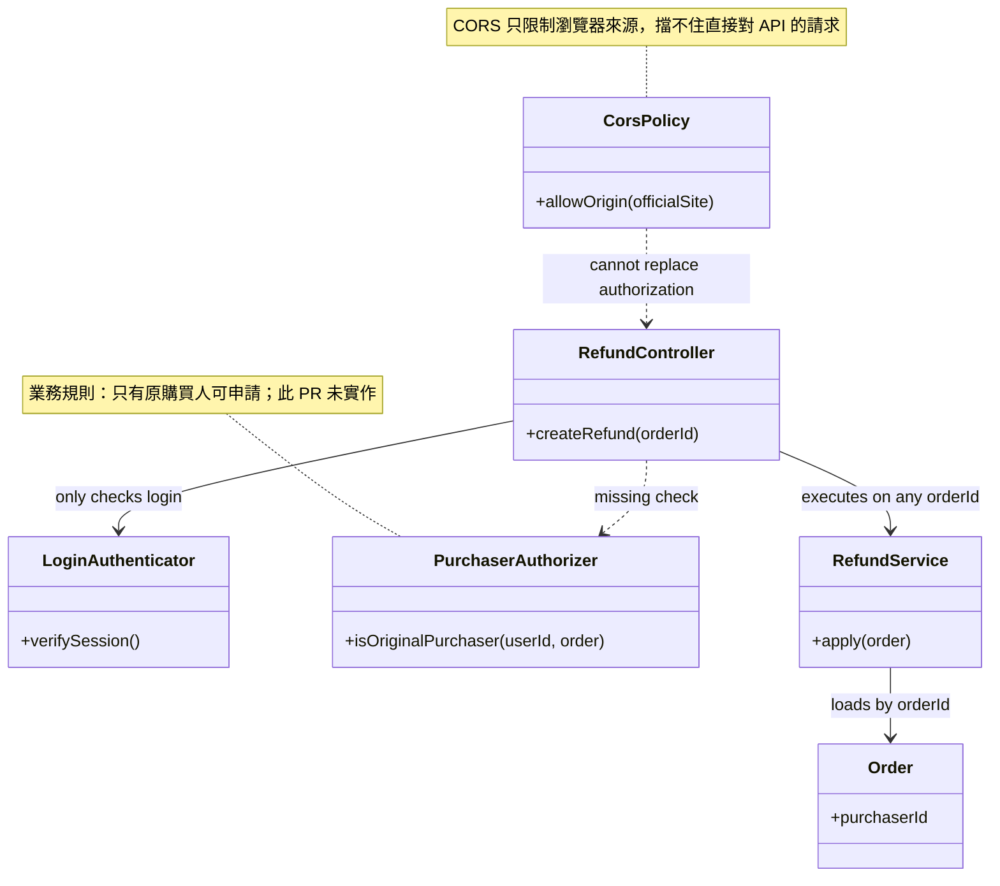
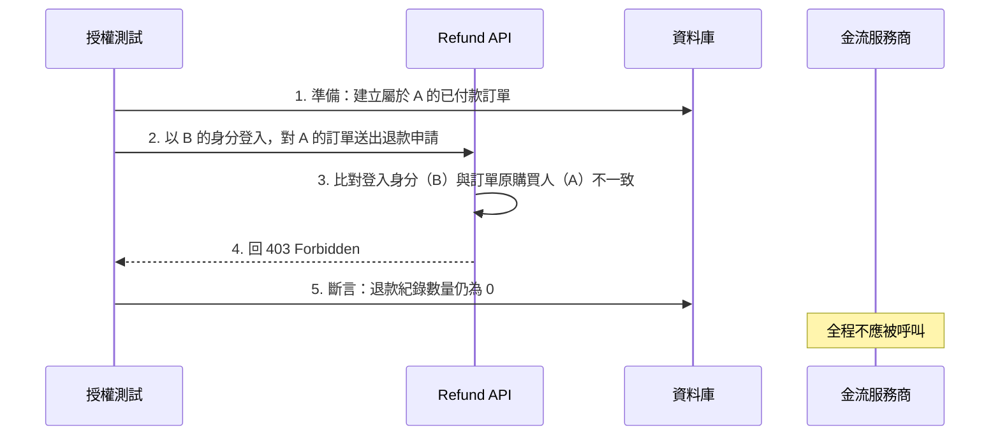
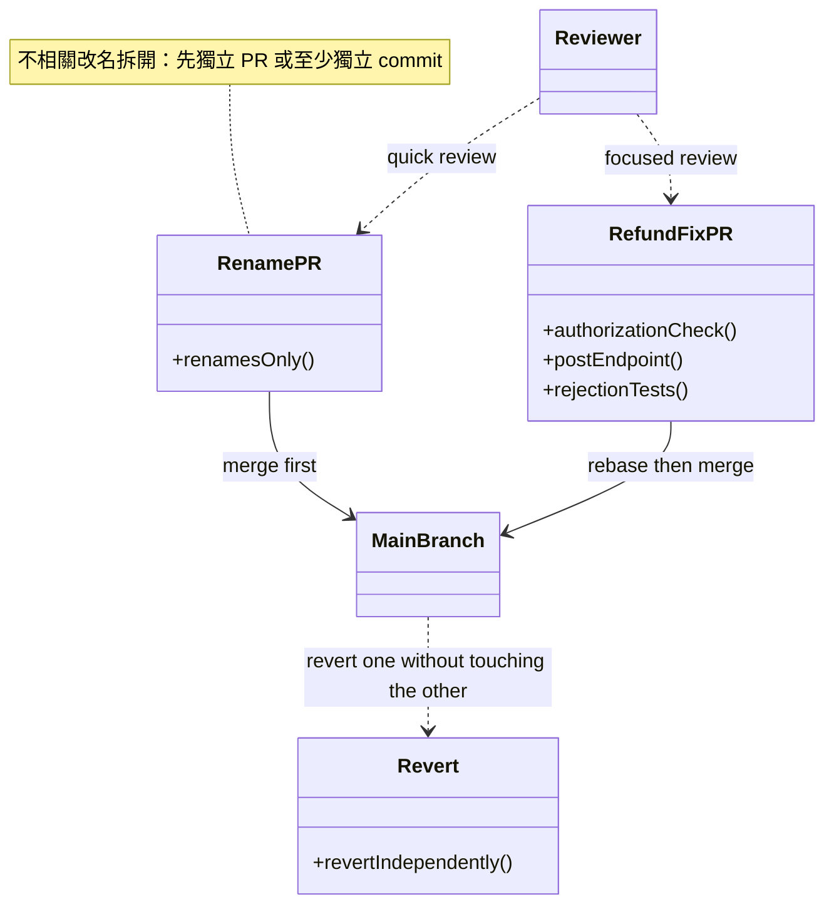
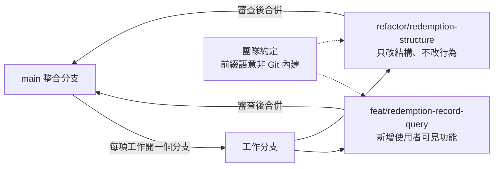
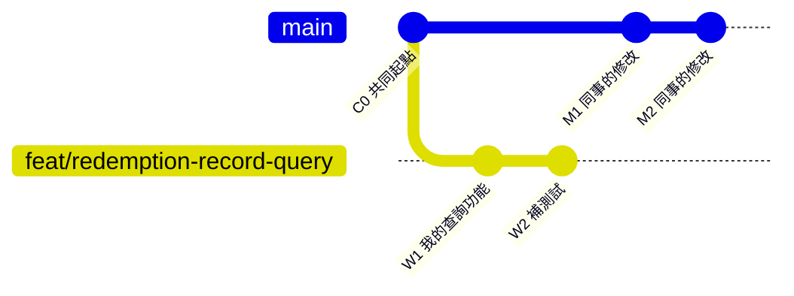
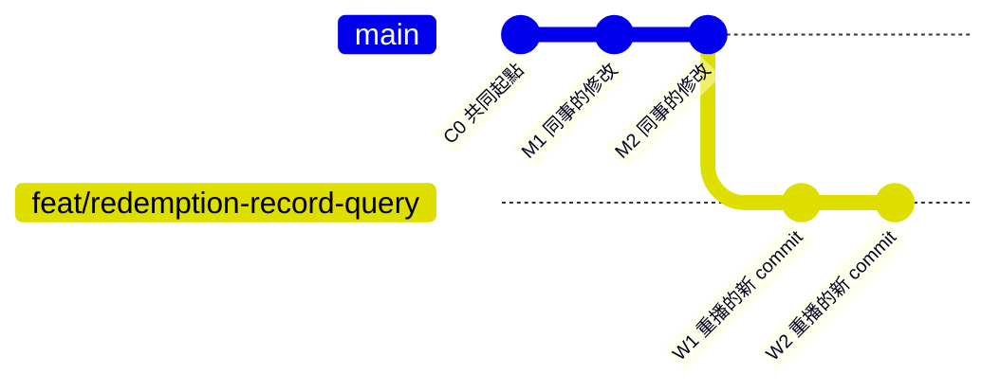
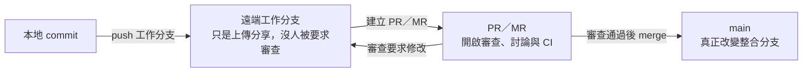
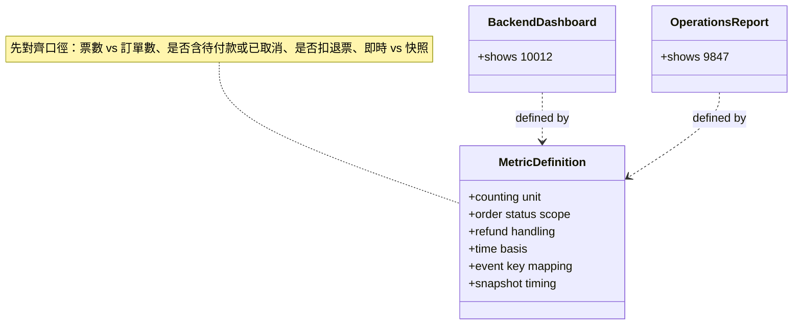
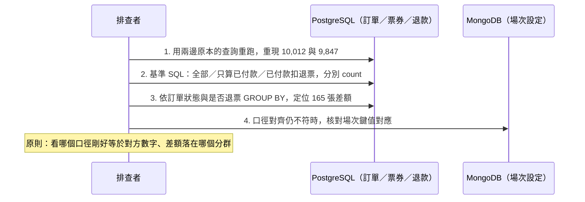
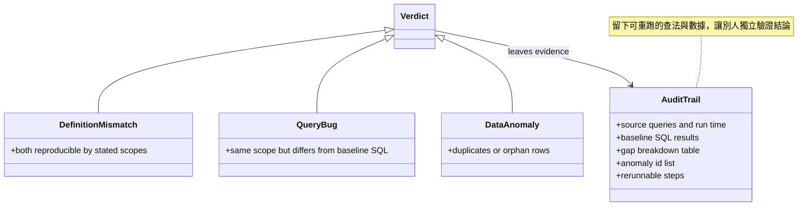

# 台鋼新零售全端工程師筆試｜情境六～九

> 本作答依題目條件推演。題目未明訂之實作細節皆列為設計假設；類別圖旨在釐清領域角色、職責劃分與相依關係，非指唯一實作藍圖。

# 情境六｜登入了，就能操作嗎？

## 第 1 題：會讓這份 PR 通過嗎？最需要先處理的兩個問題

不會通過，我會 Request changes。最需要先處理的兩個問題：

| PR 中的做法 | 問題 | 可能後果 |
|---|---|---|
| API 只驗證「已登入」，依 orderId 取得訂單後就執行，未比對原購買人 | 缺少操作授權：登入只證明「你是會員」，不代表「你有權操作這筆訂單」（IDOR 類缺陷） | 任何登入會員只要知道或猜到 orderId，就能替別人的訂單申請退款，直接造成金錢損失與客訴 |
| 用 `GET /refund?orderId=...` 呼叫後直接建立退款申請 | GET 依 HTTP 語意應是安全、可快取的讀取操作，不該有副作用 | 瀏覽器預載、爬蟲、CDN、監控探針或網路重試都可能自動重發 GET，造成誤觸或重複建立退款申請 |

另外要指出觀念錯誤：CORS 只約束瀏覽器的跨來源行為，擋不住直接對 API 發出的請求（curl、Postman、另一台伺服器），所以「CORS 僅允許官網來源」不能當作授權依據。業務規則「只有訂單的原購買人可以申請自助退款」必須在後端以「登入身分 vs 訂單 purchaserId」比對落實；建立退款應改為 `POST /orders/{orderId}/refunds` 之類的寫入方法。



## 第 2 題：會補哪個測試？預期得到什麼結果？

現有測試只有一個 mock 成功案例，沒有涵蓋業務規則的拒絕路徑。我會優先補「非原購買人被拒絕」的授權測試：

| 測試案例 | 前置 | 操作 | 預期結果 |
|---|---|---|---|
| 非原購買人申請退款 | 訂單屬於使用者 A；使用者 B 已登入 | B 對 A 的訂單送出退款申請 | 回 `403 Forbidden`；不建立退款申請、不呼叫金流 |
| 未登入請求 | 無有效 session | 直接呼叫退款 API | 回 `401 Unauthorized` |
| 原購買人申請（對照組） | A 已登入，訂單屬於 A 且符合退款資格 | A 送出申請 | 受理並進入退款流程 |

同一份測試用 Gherkin 可執行規格表示：

```gherkin
Feature: 自助退款申請
  業務規則：只有訂單的原購買人可以申請自助退款

  Scenario: 非原購買人申請退款應被拒絕
    Given 訂單 O 的原購買人是 A，且訂單已付款
    And B 已登入，但 B 不是原購買人
    When B 對訂單 O 送出退款申請
    Then 系統回應 403 Forbidden
    And 不建立任何退款申請紀錄
    And 金流服務商未被呼叫

  Scenario: 未登入的請求應被拒絕
    Given 訂單 O 已付款
    When 一個未登入的請求對訂單 O 送出退款申請
    Then 系統回應 401 Unauthorized

  Scenario: 原購買人申請退款被受理
    Given 訂單 O 的原購買人是 A，且訂單已付款
    And A 已登入
    When A 對訂單 O 送出退款申請
    Then 系統受理申請並進入退款流程
```

第一個案例最關鍵：它直接驗證本題業務規則「只有原購買人可以申請」，也是這份 PR 漏掉的路徑。測試應打在真實的授權邏輯上，而不是 mock 掉授權本身。這個測試的動作順序如下圖（照時間從上往下讀）：



## 第 3 題：不相關的檔名修改怎麼安排？怎麼讓變更好審查、好回退？

| 安排 | 做法 | 好處 |
|---|---|---|
| 拆成獨立 PR | 純檔名修改先送一個 PR（不含行為改變），退款修正另一個 PR，後者 rebase 到前者合併後的 main | 改名 PR 可快速看過；退款 PR 的 diff 只剩業務相關改動，審查聚焦 |
| 若暫時維持同一 PR | 至少分成獨立 commit：一個 commit 純改名、一個 commit 功能修改，並在 PR 描述說明順序 | 審查者可逐 commit 檢視，不會混在一起 |
| 出問題時的回退 | 兩個變更各自獨立 revert | 回退退款功能不會把改名一起倒回去，反之亦然 |

原則是一個 PR 只做一件事。不相關的改名會放大 diff、稀釋審查注意力，也會讓回退變成綁在一起的全有或全無。



# 情境七｜從工作分支，到一起交付

## 第 1 題：工作分支的用途、分支命名，以及前綴是 Git 內建還是團隊約定？

工作分支的用途是把進行中的修改與 main 隔離：main 保持可整合、可交付的狀態；一項工作一個分支，方便獨立開發、測試、審查與回退。

| 工作 | 分支名稱 | 前綴想傳達 |
|---|---|---|
| 新增贈品核銷紀錄查詢 | `feat/redemption-record-query` | feat：新增使用者可見的功能，審查重點在行為是否正確 |
| 整理既有核銷程式、不改變行為 | `refactor/redemption-structure` | refactor：只改結構、不改行為，審查不用找行為差異，重點在可讀性與測試仍全綠 |

這些前綴是**團隊約定**，不是 Git 的內建功能。Git 只把分支名當字串、把斜線當路徑分隔；前綴的語意來自團隊規範（常搭配 conventional commits 或分支流程文件），讓人從名稱就能判斷工作性質與審查重點。分支與前綴的關係：



## 第 2 題：把工作分支 rebase 到最新 main 是在做什麼？前後差異與一個注意事項

rebase 是把自己分支上的 commit「拔下來，逐一重播到最新 main 的尾端」，讓歷史看起來像是從最新 main 直接長出來的；重播過程中若與同事的修改衝突，就逐個 commit 解決。

| 面向 | rebase 前 | rebase 後 |
|---|---|---|
| 分支起點 | 從較舊的 main 分岔 | 改接到最新 main 的尾端 |
| 與同事的修改 | 分叉並行，落後 main 上的新 commit | 我的 commit 排在同事的 commit 之後，呈線性 |
| commit hash | 原本的值 | 全部改變（歷史被重寫） |

操作前要留意的一件事：rebase 會重寫歷史。如果分支已經 push 過，要確認只有自己在使用它（沒有同事基於它開發），重 push 時用 `--force-with-lease` 而非強制覆蓋；操作前也確認工作區乾淨，免得衝突解到一半汙染未提交的修改。前後差異用 gitGraph 表示：

**rebase 前（我的分支從舊 main 分岔）：**



**rebase 後（我的 commit 重播到最新 main 尾端，hash 改變）：**



## 第 3 題：PR 與 MR 各指什麼？push、建立 PR/MR、合併進 main 有什麼不同？

PR 是 Pull Request（GitHub、Bitbucket 用語），MR 是 Merge Request（GitLab 用語），本質是同一件事：請求把某個分支合併進目標分支的協作單元。它們在流程中扮演「程式碼進 main 之前的閘門」，承載審查留言、討論、核准紀錄與 CI 檢查結果。

| 動作 | 本質 | 在流程中的角色 |
|---|---|---|
| push 工作分支 | 把本地 commit 上傳到遠端 | 只是備份與分享，沒有人被要求審查，main 不受影響 |
| 建立 PR／MR | 正式提出「請把我的分支合併進 main」 | 開啟審查與討論，觸發 CI；此時 main 仍未改變 |
| 合併進 main | 審查通過後執行 | 真正改變整合分支，之後所有人的工作都以此為基礎 |

三個動作的流程：



# 情境八｜當 AI 成為搭檔，你會怎麼開始？

以下以新增「贈品核銷紀錄查詢」為例。我的做法是把合作建成一條 SDD 工作流：Specify →（Clarify）→ Plan → Tasks → Implement，每個階段都有歸檔的產出檔案與核准閘門，而不是靠對話臨時指揮。

## 第 1 題：開始之前，會先給 Agent 哪些資訊？為什麼？

與其在對話裡口頭交代，我會先把脈絡**落成檔案**，讓 Agent 讀取可重用的資產：

| 給 Agent 的資訊 | 形式 | 為什麼 |
|---|---|---|
| 需求規格（Specify 的產出） | 歸檔的 spec：查詢條件、欄位、分頁、驗收條件、「完成」的定義 | 規格驅動開發：開發由規格驅動，不靠它猜需求 |
| 專案憲法 | 歸檔的慣例文件：架構分層（use case／port／adapter）、命名、分支與提交格式、不能動的範圍 | 約束每次互動自動生效，不用重複交代 |
| 程式脈絡 | 相關模組入口、負責檔案、既有測試，請它先讀並回述理解 | Agent 的輸出品質取決於脈絡；先讀再動手才能沿用既有慣例 |
| 工作方式 | 反覆使用的流程抽成 Skill／Prompt 檔（例如「先提案等 Confirm」、「TDD 紅綠重構」） | 沉澱成資產，下次同類工作直接重用 |

理由是：AI 很會寫程式也很懂架構，它唯一不知道的是「我想要什麼」。把需求、慣例、邊界寫成檔案，就是把「我想要什麼」固定下來，資訊落差最小，也能累積成下一次的複利。

## 第 2 題：哪些工作交給它？什麼時候停下來確認或調整方向？

按 SDD 流程分工，閘門設在階段交界：

| 階段 | 交給 Agent 的事 | 我停下來確認的閘門 |
|---|---|---|
| Specify | 依訪談整理規格草稿 | 規格由我定稿才往下走 |
| Clarify（可選） | 針對規格主動提問，對模糊處出選擇題並給建議選項 | 我拍板回答；答不出的標「待確認」寫回規格 |
| Plan | 提出 60–70% 完整度的技術規劃與設計提案 | **提案 Review 後、我說 Confirm 才准實作** |
| Tasks | 把計畫分割擊破成小任務 | 任務粒度太大就請它重拆 |
| Implement | 逐項實作，配 TDD／可執行規格自動驗證，跑測試與 lint | 每個 task 看測試證據；規格外假設、改到無關模組、想放寬測試時人工介入 |

調整方向的訊號：如果它在同一個問題上連續打轉，就回到錯誤訊息與程式本身形成具體假設，換個指示或縮小範圍，不讓它無限重試。
如果是流程本身不順（同一種交代反覆出現），就把那個環節後設抽成 Prompt／Skill 檔——改進的是工作流本身，不只是這次的產出。

## 第 3 題：Agent 說「完成了」，你會先看什麼？什麼情況接受、什麼情況請它再改？

| 先看什麼 | 判斷 |
|---|---|
| 驗證證據：驗收條件對應的測試全綠、lint 通過、實際跑了哪些指令 | 沒有證據不算完成 |
| 對照規格：產出是否就是 spec 與 plan 階段核准的內容 | 偏離核准範圍就要問 |
| diff 範圍：是否只動了該動的檔案、有沒有夾帶無關修改 | 範圍正確才進下一步 |
| 關鍵邏輯親自讀一遍（金流、授權、併發等不能只看測試的路徑） | 看不懂的程式不能進 main |

接受的情況：範圍正確、驗證通過、關鍵路徑我讀得懂且同意設計、PR 描述完整。
請它再改的情況：夾帶無關修改、為了過測試而放寬斷言、出現沒討論過的設計決策，或產出我解釋不了的程式。

無論接受或再改，最後都做一件回饋：盤點這次哪裡順、哪裡返工；值得重複的做法就沉澱成 Prompt／Skill 檔——工作流是迭代出來的，不是一次餵出來的。

# 情境九｜數字對不上，差異從哪裡來？

## 第 1 題：先確認哪些定義？哪些差異可能只是「算的東西不一樣」？

破題思路：這題是調查型任務，產出不是新功能，而是一個結論。我會延續情境八的工作流思維，但把流程換成調查版——先把兩個數字的定義與來源查清楚（對應 Specify／Clarify），再拆成可驗證的小步逐步縮小（對應 Plan／Tasks）；全程唯讀，查明原因前不修資料、不改查詢，免得汙染證據；最後留下能讓別人重跑驗證的紀錄（對應驗收）。若最終結論是「查詢寫錯」，修復本身才進入情境八的 SDD 開發流程。

| 定義面向 | 可能的口徑差異 | 怎麼確認 |
|---|---|---|
| 計數單位 | 票券張數 vs 訂單筆數（一筆訂單可含多張票） | 看兩邊查詢數的是 tickets 還是 orders |
| 訂單狀態 | 只算已付款，或把待付款、已取消也算進去 | 檢查兩邊查詢的 where 條件 |
| 退款處理 | 是否扣除已退票的票券 | 檢查是否過濾已退款票券 |
| 時間口徑 | 以購買時間、付款時間或場次結束時間切 | 對齊使用的時間欄位 |
| 場次對應 | PostgreSQL 的 eventId 與 MongoDB 場次設定的鍵是否一致 | 比對兩邊用來對應場次的鍵值 |
| 更新時機 | 後台即時查詢 vs 報表離線快照（例如 T+1） | 問報表的產製排程與資料截止時間 |

以上每一項都可能只是「雙方算的東西不一樣」：例如後台即時數含待付款訂單的票、報表快照只算已付款，就會出現這種差距，不代表資料壞了。先對齊定義再查資料，才不會把口徑差當成 bug 追。



## 第 2 題：怎麼一步一步縮小問題？查法與順序

| 步驟 | 做法 | 目的 |
|---|---|---|
| 1. 重現兩個數字 | 找到後台與報表各自的查詢（或程式碼），用同一場次重跑，確認穩定得到 10,012 與 9,847 | 確認問題可重現，不是暫時性或看錯場次 |
| 2. 建立基準計數 | 直接對 PostgreSQL 下最小 SQL，各口徑分別 count | 看哪個口徑剛好等於哪個數字 |
| 3. 差額分群 | 依訂單狀態、是否退票 GROUP BY，找出 165 張差額落在哪個分群 | 把差異定位到最小範圍 |
| 4. 查資料異常 | 口徑對齊後仍不一致，才查重複票、孤兒票（訂單不存在）、狀態矛盾、MongoDB 場次鍵對應錯誤 | 確認是否資料本身真的壞了 |

第 2 步的基準 SQL 例如：`SELECT count(*) FROM tickets t JOIN orders o ON t.order_id = o.id WHERE o.event_id = :eid`（全部）、加上 `AND o.status = 'paid'`（只算已付款）、再加 `AND t.refunded_at IS NULL`（扣掉已退票）。如果 10,012 是「全部」、9,847 是「已付款且未退票」，差額 165 又能被狀態分群完整解釋，就是口徑問題；對不上才往資料異常查。四個步驟的執行順序如下圖（從上往下讀）：



## 第 3 題：怎麼判斷是定義不同、查詢問題還是資料異常？留下哪些資訊？

| 判斷 | 特徵 | 後續處理 |
|---|---|---|
| 統計定義不同 | 兩個數字都能用明確口徑重現，且口徑差恰好解釋差額（例如 165 恰好是待付款＋已取消訂單的票數） | 對齊口徑、把定義寫進報表說明，不改資料 |
| 查詢邏輯問題 | 同一口徑下，報表查詢的結果與手寫基準 SQL 不一致（join 遺漏、條件寫錯、快照過期） | 修查詢或調整快照排程 |
| 資料異常 | 基準 SQL 也對不上，且能列出具體異常資料列（重複票、孤兒票、狀態矛盾如已取消卻有有效票） | 走資料修復流程，並記錄修復依據 |

會留下的資訊：兩邊數字的來源查詢與執行時間；我用的基準 SQL、各口徑的 count 結果與差額分群表；最終結論與判斷依據；若有資料異常，附上異常票的 id 清單。所有查法都可重跑，讓別人能獨立驗證同樣的結論。



# 延伸分享｜有沒有一次，你改變了與 AI 合作的方式？

以前是一句一句的 Vibe Coding：想到什麼就餵什麼，結果 AI 自行補了規格外的假設、產出很難審的大 diff。現在改用 SDD：需求先落成規格檔，設計提案經我 Confirm 才分段實作，每段都要求測試與 lint 的證據，來回次數與返工大幅降低。

需求散在對話裡，還有一個麻煩是：後來改掉的決定，前面的版本仍然留著。把整串重新交給 AI，也不一定知道哪些已經作廢。規格檔值得留下的是「現在要做的版本」，不用把每次討論都塞進去。

再下一步，是把反覆出現的交代（例如「先提案、等 Confirm」）後設抽成 Prompt／Skill 檔，讓工作流本身也能迭代累積。
