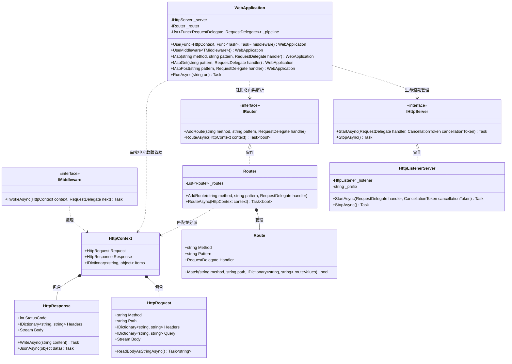

## 類別設計

## 設計說明

- 類別職責：
  - `HttpContext`：封裝單次 HTTP 請求與回應的上下文環境，提供生命週期內共用的資料儲存容器。
  - `HttpRequest`：抽象化請求資料（HTTP Method、Path、Headers、Query 參數及 Body 串流）。
  - `HttpResponse`：抽象化回應操作（StatusCode、Headers、Body 串流以及輔助輸出方法如 `WriteAsync`、`JsonAsync`）。
  - `IMiddleware`：定義可插入請求管線（Middleware Pipeline）的中介軟體契約。
  - `Route`：表示單一路徑規則，包含 HTTP 方法、路由模板、處理常式，並支援路由參數比對與解析。
  - `IRouter` 與 `Router`：負責維護所有路由規則，並在收到請求時進行比對與分派。
  - `IHttpServer` 與 `HttpListenerServer`：抽象底層網路傳輸與監聽協定，`HttpListenerServer` 基於 .NET 的 `HttpListener` 接收連線，轉成 `HttpContext` 後交由管線處理。
  - `WebApplication`：框架門面（Facade），提供 Fluent API 供使用者註冊中介軟體（`Use`）、註冊端點（`MapGet`、`MapPost`）並啟動應用程式伺服器（`RunAsync`）。
- 關係與設計意圖：
  - `HttpContext` 組合了 `HttpRequest` 與 `HttpResponse`，生命週期一致。
  - `HttpListenerServer` 實作 `IHttpServer`，將伺服器具體通訊與 WebApplication 解耦，未來可擴充不同通訊介面（如 Kestrel 或自製 Socket）。
  - `Router` 實作 `IRouter` 並管理 `Route` 集合，與中介軟體管線解耦，使路由可作為管線終端處理器或獨立中介軟體執行。
  - `WebApplication` 整合 `IHttpServer`、`IRouter` 與中介軟體管線（以 `RequestDelegate` 委派鏈接），遵循洋蔥模型（Onion/Russian Doll Pipeline）。
- 實作順序：
  1. 定義委派核心型別 `RequestDelegate` 與基礎抽象模型（`HttpRequest`、`HttpResponse`、`HttpContext`）。
  2. 定義 `IMiddleware` 介面及中介軟體擴充機制。
  3. 實作 `Route` 與 `Router`（支援基本路徑與具名參數如 `{id}` 解析）。
  4. 實作 `IHttpServer` 與 `HttpListenerServer`（處理連線生命週期與 `HttpListenerContext` 轉型為 `HttpContext`）。
  5. 實作 `WebApplication`（串接洋蔥管線、路由註冊便利函式與伺服器驅動迴圈）。
  6. 提供示範程式（範例應用程式：包含靜態路由、動態參數路由、JSON 回應與中介軟體記錄日誌）。

