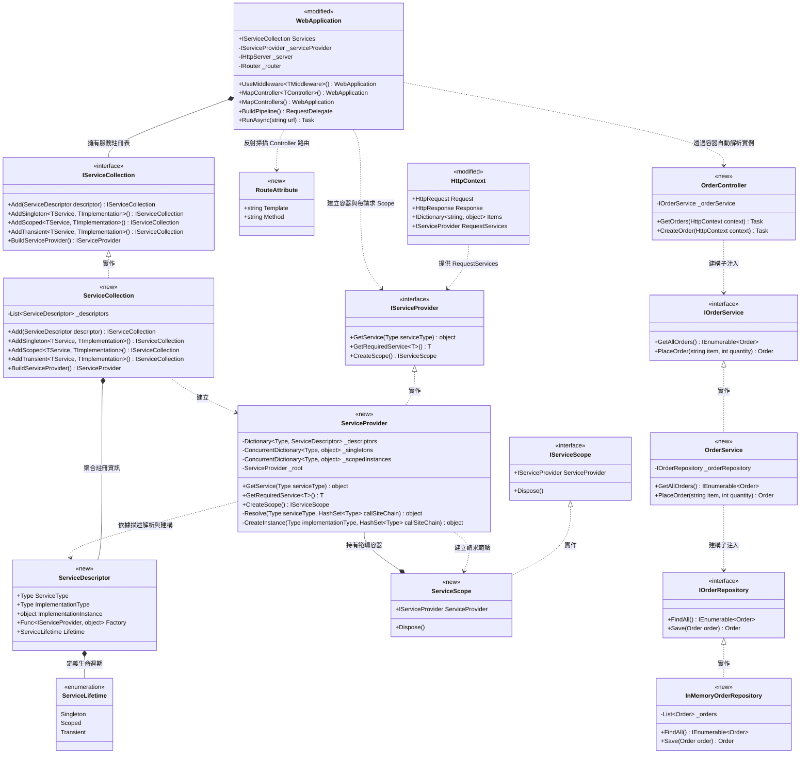

## 類別設計

## 設計說明

- 類別職責：
  - `ServiceLifetime`（`<<new>>`）與 `ServiceDescriptor`（`<<new>>`）：描述服務的抽象型別、具體實作型別、工廠委派與生命週期（`Singleton` 應用程式單例、`Scoped` 每請求單例、`Transient` 每次解析新建）。
  - `IServiceCollection`（`<<new>>`）與 `ServiceCollection`（`<<new>>`）：提供流暢的依賴註冊 API（`AddSingleton`、`AddScoped`、`AddTransient`），並在啟動時建構出 `IServiceProvider`。
  - `IServiceProvider`（`<<new>>`）、`ServiceProvider`（`<<new>>`）與 `IServiceScope`（`<<new>>`）、`ServiceScope`（`<<new>>`）：IoC 核心引擎。負責依型別遞迴分析最匹配建構子（Constructor Injection）、自動解析整條依賴鏈、偵測循環依賴，並管理每個 HTTP 請求獨立的 `Scoped` 實例生命週期與資源釋放。
  - `RouteAttribute`（`<<new>>`）：標註於 Controller 類別與 Action 方法上的路由與 HTTP 方法屬性（如 `[Route("GET", "/orders")]`）。
  - `HttpContext`（`<<modified>>`）：於既有請求上下文新增 `RequestServices` 屬性，供單次 HTTP 請求解析範疇服務。
  - `WebApplication`（`<<modified>>`）：於既有門面新增 `Services`、`MapController<TController>()`、`MapControllers()` 與 `BuildPipeline()`，並升級 `UseMiddleware<TMiddleware>()` 與 `RunAsync()` 以支援建構子注入及每請求 `IServiceScope`。
  - `OrderController`（`<<new>>`）、`IOrderService` / `OrderService`（`<<new>>`）、`IOrderRepository` / `InMemoryOrderRepository`（`<<new>>`）：驗證三層自動注入（Controller → Service → Repository）的示範情境類別。
- 刪除項：無。
- 關係與設計意圖：
  - `ServiceCollection` 組合多筆 `ServiceDescriptor`，並在 `BuildServiceProvider()` 時交由 `ServiceProvider` 建立快取與解析索引，分離「註冊期」與「解析期」職責。
  - `ServiceProvider` 透過反射遞迴解析建構子參數，使 `OrderController` 只需宣告依賴 `IOrderService`、`OrderService` 只需宣告依賴 `IOrderRepository`，無須手動 `new` 任何實作類別；同時利用 `callSiteChain` 偵測並攔截循環依賴（如 A → B → A）。
  - `WebApplication` 透過每次請求建立 `IServiceScope`，確保 `Scoped` 服務（如 `OrderService`）在同一個請求內共用實例、不同請求間彼此隔離，而 `Singleton`（如 `InMemoryOrderRepository`）則跨請求保存資料。
- 實作順序：
  1. 新增 `ServiceLifetime` 與 `ServiceDescriptor`（無外部相依的基礎資料模型）。
  2. 新增 `IServiceProvider`、`IServiceScope`、`IServiceCollection` 介面。
  3. 新增 `ServiceCollection`、`ServiceProvider` 與 `ServiceScope`（含遞迴建構子注入、未註冊具體類別自動建構、循環依賴偵測與生命週期快取）。
  4. 新增 `RouteAttribute`，並修改既有 `HttpContext`（新增 `RequestServices`）與 `WebApplication`（新增 `Services`、支援 `IMiddleware` 依賴注入、Request Scope 自動管理與 `MapController` 路由綁定）。
  5. 於範例專案新增 `InMemoryOrderRepository` → `OrderService` → `OrderController` 三層架構，並實際執行驗證完整注入鏈與請求隔離行為。
