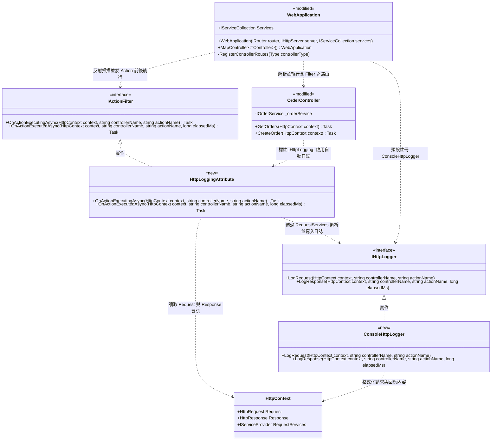

## 類別設計

## 設計說明

- 類別職責：
  - `IHttpLogger`（`<<new>>`）與 `ConsoleHttpLogger`（`<<new>>`）：負責在 HTTP 請求進入與 HTTP 回應輸出兩個時間點記錄日誌（包含控制器與方法名稱、HTTP Method、Path、Query、狀態碼與耗時）。
  - `IActionFilter`（`<<new>>`）：定義 Controller Action 執行前（`OnActionExecutingAsync`）與執行後（`OnActionExecutedAsync`）的攔截器契約。
  - `HttpLoggingAttribute`（`<<new>>`）：實作 `IActionFilter` 的 C# Attribute（`[HttpLogging]`），可掛載於整個 Controller 類別或單一 Action 方法上；在請求進入與回應輸出時由 `HttpContext.RequestServices` 取得 `IHttpLogger` 寫入日誌。
  - `WebApplication`（`<<modified>>`）：於建構時預設註冊 `IHttpLogger -> ConsoleHttpLogger`（使用者亦可自訂替換）；修改 `RegisterControllerRoutes()` 掃描 Controller 類別與 Action 方法上的 `IActionFilter` 屬性，在呼叫 Action 前觸發 `OnActionExecutingAsync`、Action 完成並準備輸出回應時觸發 `OnActionExecutedAsync`。
  - `OrderController`（`<<modified>>`）：於類別掛上 `[HttpLogging]` 屬性，使 `GetOrders` 與 `CreateOrder` 自動享有請求與回應雙時間點日誌能力。
  - `HttpContext`（未變更上下文）：提供 `Request`、`Response` 與 `RequestServices` 供 Filter 與 Logger 讀取。
- 刪除項：
  - `<<to-be-removed>> RequestLoggingMiddleware`（刪除 `samples/WebFramework.Sample/Program.cs` 中舊有的範例手動日誌中介軟體類別及其 `app.UseMiddleware<RequestLoggingMiddleware>()` 註冊呼叫，改由框架內建的 `[HttpLogging]` 裝飾器取代）。
- 關係與設計意圖：
  - 透過 `IActionFilter` 介面與 `HttpLoggingAttribute` 將「宣告哪個 Controller 需要日誌」與「框架管線如何攔截執行」解耦；使用者只需在 `OrderController` 標註 `[HttpLogging]` 即可生效。
  - `HttpLoggingAttribute` 透過 `HttpContext.RequestServices` 解析 `IHttpLogger`，兼顧 Attribute 標記的便利性與 IoC 容器的可替換性。
- 實作順序：
  1. 新增 `IHttpLogger` 介面與 `ConsoleHttpLogger` 預設實作。
  2. 新增 `IActionFilter` 介面與 `HttpLoggingAttribute` 裝飾器屬性。
  3. 修改 `WebApplication`，預設註冊 `IHttpLogger` 並在 `RegisterControllerRoutes` 中串接 `IActionFilter` 的請求前／回應後攔截流程。
  4. 修改 `OrderController` 掛上 `[HttpLogging]`，並於 `samples/WebFramework.Sample/Program.cs` 移除 `<<to-be-removed>> RequestLoggingMiddleware`，執行驗證展示結果。
